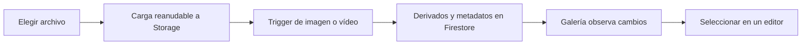

# Dashboard de Laura Butallo

Origen: `laura-butallo-web/apps/admin-dashboard`.

## Qué tipo de dashboard es

Es una aplicación administrativa independiente con Next.js App Router, React y Tailwind, construida sobre un starter de shadcn/Radix. Tiene estructura por funcionalidades, sidebar colapsable, cabecera, breadcrumbs, tablas, formularios, diálogos y biblioteca de medios.

La adaptación más relevante es que **prioriza tareas editoriales**: `/dashboard` redirige al organizador de obras. Para Error404 es una buena referencia de panel de contenidos, más que de pantalla inicial de métricas.

El manifiesto declara Next `^16.0.7`, React `^19.2.0`, Firebase, TanStack Table, Nuqs, React Hook Form, Zod, dnd-kit, Quill y Zustand. Son versiones declaradas, no una comprobación de las versiones instaladas ni una recomendación de actualización. [Paquete](../../../laura-butallo-web/apps/admin-dashboard/package.json).

## Estructura

```text
apps/admin-dashboard/src/
  app/
    auth/                       Acceso
    dashboard/                  Rutas del panel
    api/download/               Descarga de archivos
  components/
    layout/                     Shell, cabecera, sidebar, control visual de acceso
    ui/                         Primitivas shadcn/Radix y tablas
    forms/                      Campos y editor de texto
  features/
    works-organizer/            Organización de filas y medios
    exhibitions/                Listado y edición
    gallery/                    Biblioteca de imágenes y vídeos
    about/ y contact/           Contenido institucional
    products/, overview/, ...   También quedan módulos del starter
  contexts/auth-session.tsx     Sesión Firebase + contexto de organización demo
  lib/                        Firebase, carga y resolución de medios
  config/nav-config.ts        Navegación declarativa

functions/src/                Procesamiento de medios y funciones callable
apps/web/                     Web pública que consume el contenido
firestore.rules / storage.rules
```

El panel depende del proyecto raíz para funciones y reglas. Extraer únicamente `apps/admin-dashboard` no reproduce la cadena completa de carga y procesamiento de archivos.

## Funcionalidad real frente a demostraciones

| Área                                 | Implementación observada                                                                 | Lectura para Error404                                                                |
| ------------------------------------ | ---------------------------------------------------------------------------------------- | ------------------------------------------------------------------------------------ |
| Acceso                               | Google mediante Firebase Auth; lista de usuarios autorizados consultada desde Firestore. | Existe acceso real, con autorización de interfaz que debe reforzarse en backend.     |
| Obras                                | Categorías Home/Caves/Landscapes; filas, asignación de medios, orden y proporciones.     | Útil como patrón para ordenar secciones; no reutilizar esas categorías literalmente. |
| Exhibiciones                         | Consulta en tiempo real, creación, edición, portada, adjuntos y orden.                   | Base conceptual para eventos, agregando campos específicos.                          |
| Galería                              | Carga, procesamiento, selección, vista ampliada, títulos y descarga.                     | Es uno de los módulos más reutilizables.                                             |
| About Me                             | Texto enriquecido, imagen y bloque educativo; guardar y deshacer cambios.                | Adaptar a About del sello; descartar los campos propios de una artista.              |
| Contacto                             | Filas con etiqueta/URL y orden manual, guardadas en Firestore.                           | Útil para correos, redes, distribución y booking.                                    |
| Productos                            | `fakeProducts` en listado y detalle; formulario que imprime valores y navega.            | No gestiona Shopify, stock ni pedidos. Es una referencia de UI.                      |
| Organizaciones                       | `demoOrganizations` con planes, miembros y almacenamiento de ejemplo.                    | No equivale a multitenencia real.                                                    |
| Overview, billing, exclusive, kanban | Rutas heredadas del starter; no se estableció una fuente comercial real.                 | Excluir del primer panel salvo necesidad concreta.                                   |

Evidencia: [entrada del panel](../../../laura-butallo-web/apps/admin-dashboard/src/app/dashboard/page.tsx), [sesión](../../../laura-butallo-web/apps/admin-dashboard/src/contexts/auth-session.tsx), [productos demo](../../../laura-butallo-web/apps/admin-dashboard/src/features/products/components/product-listing.tsx), [formulario demo](../../../laura-butallo-web/apps/admin-dashboard/src/features/products/components/product-form.tsx).

## Navegación y orientación

**Aciertos observados**

- La configuración de navegación está centralizada y permite cambiar títulos, iconos, rutas y grupos sin editar toda la sidebar.
- La sidebar tiene modo compacto; en móvil se cierra después de elegir una ruta.
- La cabecera conserva breadcrumbs y herramientas de sesión/tema.
- Entrar directamente a una tarea editorial reduce pasos para quien trabaja habitualmente en contenidos.

**Aspectos que conviene adaptar**

- El menú mezcla castellano e inglés: Organizador de Obras, About Me, Workspaces, Teams, Product y Pro. En Error404 conviene usar un idioma administrativo consistente.
- `useFilteredNavItems` reduce el menú en `NEXT_PUBLIC_DEPLOY_ENV=prod`; esconder enlaces por entorno no bloquea las rutas ni sus operaciones.
- El estado activo usa igualdad exacta con `pathname`; un detalle como `/dashboard/exhibitions/ID` puede perder la marca activa del módulo principal.
- KBar existe en el layout, pero el buscador de cabecera está comentado. No asumir que todo control del starter está expuesto.
- El root usa `lang='en'` mientras buena parte del panel está en castellano.

Fuentes: [menú](../../../laura-butallo-web/apps/admin-dashboard/src/config/nav-config.ts), [filtrado](../../../laura-butallo-web/apps/admin-dashboard/src/hooks/use-nav.ts), [sidebar](../../../laura-butallo-web/apps/admin-dashboard/src/components/layout/app-sidebar.tsx), [cabecera](../../../laura-butallo-web/apps/admin-dashboard/src/components/layout/header.tsx).

## Edición y feedback

Hay indicadores de guardado, mensajes de éxito/error y, en About y exhibiciones, detección de cambios y recuperación de valores guardados. Quill se integra con una selección de imágenes desde la biblioteca, evitando pedir URLs manuales al editor.

La UX de guardado todavía no es uniforme: ordenar filas escribe inmediatamente; About y exhibiciones requieren guardar; el título de un medio puede guardarse al perder foco. En un panel nuevo hay que hacer visible qué se guarda automáticamente y qué requiere confirmar.

No encontré un bloqueo de navegación por cambios pendientes en los formularios revisados. Mostrar “cambios sin guardar” no garantiza que no se pierdan al salir. Tampoco conviene trasladar un campo `dateAndLocation` libre al módulo Eventos: fecha, hora, zona horaria, recinto y ciudad necesitan estructura si se quieren filtros y estados fiables.

El organizador incorpora sensores de puntero y teclado. En contacto y adjuntos de exhibiciones aparecen sensores de puntero; conviene añadir alternativas de subir/bajar cuando se adapte el flujo. Una pantalla administrativa usable con teclado facilita además operaciones precisas de reordenado.

Fuentes: [About](../../../laura-butallo-web/apps/admin-dashboard/src/features/about/components/about-form.tsx), [exhibiciones](../../../laura-butallo-web/apps/admin-dashboard/src/features/exhibitions/components/exhibition-form.tsx), [contacto](../../../laura-butallo-web/apps/admin-dashboard/src/features/contact/components/contact-form.tsx), [organizador](../../../laura-butallo-web/apps/admin-dashboard/src/features/works-organizer/components/category-organizer.tsx), [Quill](../../../laura-butallo-web/apps/admin-dashboard/src/components/forms/form-quill.tsx).

## Biblioteca de medios

El flujo observado es:



Se conserva un `uploadId`, el nombre original y el contexto de uso. Hay progreso de transferencia y estados de procesamiento. Las funciones generan tamaños WebP y versiones de vídeo con poster. La interfaz permite escoger entre activos existentes, algo especialmente útil para evitar copias del mismo flyer o portada.

Limitaciones concretas:

- El pipeline modela `image | video`; **no hay un pipeline de audio** equivalente para las previews de Error404.
- `uploadMediaFiles` lanza los archivos en paralelo; habría que limitar concurrencia y distinguir errores por archivo para cargas grandes.
- La galería escucha la colección entera ordenada por fecha y filtra eliminados en el cliente. No se ve paginación en esa consulta.
- El organizador abre listeners por fila y hace lecturas de documentos de medios por ID. Para un catálogo pequeño puede ser suficiente; con mucho contenido puede multiplicar lecturas.
- Se llama “signed URL” a una utilidad que usa `getDownloadURL`; el nombre no debe interpretarse como garantía de caducidad de una URL firmada de servidor.
- La eliminación desde la galería escribe `deletedAt` directamente. Hay una función `validateDelete`, pero ese flujo no la llama. Además, su comprobación se basa en `mediaSetId`, insuficiente para las múltiples referencias actuales de About, exhibiciones y grupos de medios.

Fuentes: [carga](../../../laura-butallo-web/apps/admin-dashboard/src/lib/media-upload.ts), [galería](../../../laura-butallo-web/apps/admin-dashboard/src/features/gallery/components/media-gallery.tsx), [eliminación UI](../../../laura-butallo-web/apps/admin-dashboard/src/features/gallery/components/media-page.tsx), [guard de eliminación](../../../laura-butallo-web/functions/src/callable/validateDelete.ts), [URLs](../../../laura-butallo-web/apps/admin-dashboard/src/lib/asset-url.ts), [variantes de imagen](../../../laura-butallo-web/functions/src/utils/images.ts).

## Autenticación y permisos: hallazgos de reutilización

Esta sección describe código local, no una comprobación de la configuración desplegada.

| Hallazgo                                                  | Evidencia                                                                       | Consecuencia para la adaptación                                                                   |
| --------------------------------------------------------- | ------------------------------------------------------------------------------- | ------------------------------------------------------------------------------------------------- |
| Gate de acceso en cliente                                 | `AuthGate` espera sesión y redirige; `proxy.ts` devuelve `NextResponse.next()`. | Validar sesión también en operaciones de servidor y endpoints.                                    |
| Lista de acceso en cliente                                | `config/default.authorizedUsers` determina si la UI acepta al usuario.          | La autorización de datos no puede depender solo de ese filtro.                                    |
| Escritura de contenido para cualquier usuario autenticado | `isAuthorized()` solo comprueba `request.auth != null`.                         | Los roles `admin/editor/viewer` del contexto no restringen esas escrituras.                       |
| Escritura anónima en `assets`                             | `request.auth == null && request.time == request.time`.                         | La regla contradice el comentario que dice impedir escritura frontend. Reemplazarla; no copiarla. |
| Lectura pública general                                   | Match recursivo con `allow read: if true`.                                      | No es adecuado para borradores, configuración interna ni lista de autorizados.                    |
| Storage amplio                                            | Lectura pública; escritura para cualquier usuario autenticado.                  | Separar originales, borradores y derivados públicos; validar alcance y tipos/tamaños.             |
| Migración callable exportada sin comprobar sesión         | `migrateArtworksToAssets`.                                                      | Una utilidad de migración necesita acceso administrativo y control de repetición.                 |

Fuentes: [AuthGate](../../../laura-butallo-web/apps/admin-dashboard/src/components/layout/auth-gate.tsx), [proxy](../../../laura-butallo-web/apps/admin-dashboard/src/proxy.ts), [Firestore](../../../laura-butallo-web/firestore.rules), [Storage](../../../laura-butallo-web/storage.rules), [migración](../../../laura-butallo-web/functions/src/migration/migrateArtworksToAssets.ts).

## Reutilización recomendada

**Conservar el patrón:** shell administrativo, navegación declarativa, campos, tablas, selección de medios, feedback de guardado, separación por funcionalidades.

**Adaptar al dominio:** organizador → orden de portada; exhibiciones → eventos; About Me → sello; medios → portadas, flyers, fotos y audio; formularios de productos → solo si se conecta una fuente comercial real.

**Resolver antes de incorporar:** permisos, borradores/publicación, validación en backend, referencias de medios, paginación y uniformidad de guardado.

**Descartar al comenzar:** organizaciones ficticias, planes, billing, estadísticas demo y categorías artísticas de Laura. También conviene corregir los scripts raíz `dev:admin` y similares: apuntan a `apps/admin`, mientras la carpeta analizada es `apps/admin-dashboard`. El README del dashboard conserva texto de starter que no describe fielmente la implementación actual.
