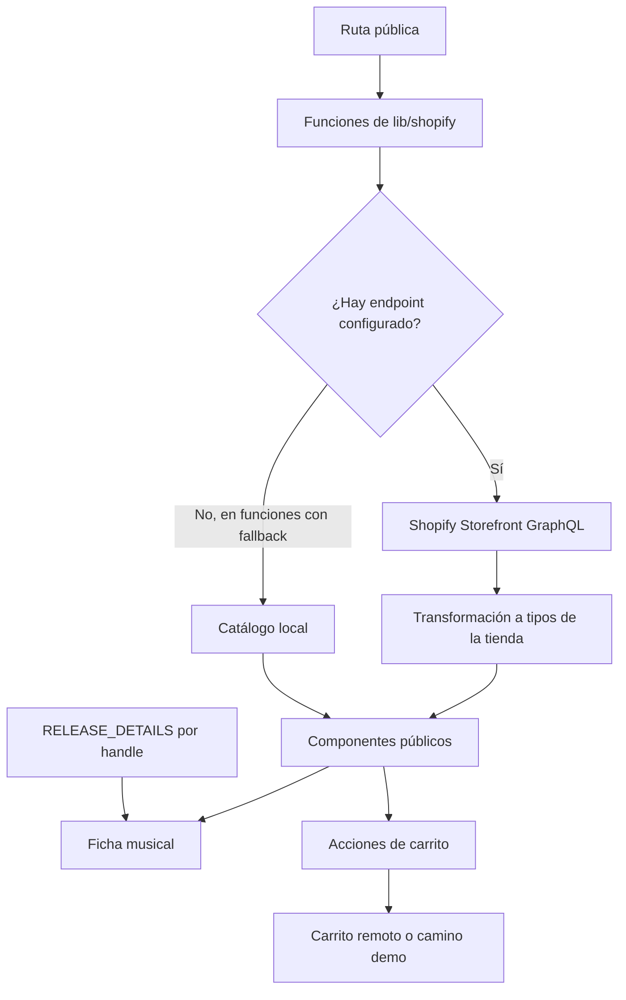

# Análisis del proyecto Error404 · web-vercel-nextjs

Revisión ampliada del **11 de octubre de 2026**. Este informe analiza el proyecto por sí mismo: arquitectura, pantallas, experiencia de compra, contenido musical, mantenimiento y preparación para producción. Las observaciones proceden del código local; los efectos visuales y los fallos potenciales se señalan como pendientes de prueba cuando corresponde.

Base analizada: este repositorio `web-vercel-nextjs`, tal como estaba en disco al realizar la revisión. Algunas clases y nombres ya difieren de ajustes anteriores de la conversación; este documento describe los archivos actuales.

## Estructura existente

Hay **6 archivos `page.tsx`** bajo `app/`: home, búsqueda, categoría, producto, checkout y página genérica de Shopify. No hay un dashboard, rutas editoriales específicas de artistas/eventos ni una sección About propia.

La app utiliza Next `15.6.0-canary.60`, React 19, Tailwind 4, Headless UI y Heroicons. La capa comercial está en `lib/shopify`; la presentación pública ocupa `components/` y `app/`. Hay caché, metadata, sitemap y una ruta de revalidación.

Fuentes: [paquete](../package.json), [layout](../app/layout.tsx), [home](../app/page.tsx), [Shopify](../lib/shopify/index.ts), [configuración](../next.config.ts).

## UX pública que ya conviene preservar

| Zona               | Estado en código                                                                           |
| ------------------ | ------------------------------------------------------------------------------------------ |
| Inicio             | Secciones Releases, Merch y Accesories; 2 columnas en móvil, 4 en md y 5 en lg.            |
| Categorías         | Listado con colecciones y orden; 4 columnas desde lg.                                      |
| Tarjetas           | Imagen cuadrada; título de hasta 3 líneas; placa que puede crecer a la altura de la fila.  |
| Producto           | Imagen principal limitada a 420 px, miniaturas, precio, texto fiscal, botón y descripción. |
| Música             | Tracklist, control visual de preview, detalles y códigos de matriz cuando existen.         |
| Relacionados móvil | Siguiente tarjeta parcialmente visible, swipe, flechas, fade derecho y espacio final.      |
| Carrito            | Drawer, variantes y operaciones optimistas con acciones de servidor.                       |

Fuentes: [secciones](../components/home/product-section.tsx), [categoría](../app/search/[collection]/page.tsx), [tarjeta](../components/grid/tile.tsx), [placa](../components/label.tsx), [galería](../components/product/gallery.tsx), [relacionados](../components/product/related-mobile-carousel.tsx).

## Datos y administración

Hay dos fuentes para el producto: Shopify cuando se define dominio y un catálogo local de muestra cuando no hay endpoint. El contenido musical adicional se toma siempre de `RELEASE_DETAILS[product.handle]`, con cuatro handles específicos. Aunque el producto venga de Shopify, cambiar su handle puede separar la ficha de sus detalles.

Los mocks incluyen imágenes importadas desde `input/`, variantes de ejemplo y etiquetas. No es una biblioteca administrable. La integración de carrito tiene un camino demo: las acciones omiten la escritura remota sin dominio y redirigen al checkout local de demostración. La existencia de la pantalla demo no demuestra que el proyecto no esté conectado en el entorno actual; no se inspeccionó `.env` ni se consultó el proveedor.

Fuentes: [catálogo local](../lib/shopify/mock-data.ts), [detalles locales](../lib/shopify/release-details.ts), [ficha](../components/product/product-description.tsx), [acciones de carrito](../components/cart/actions.ts), [checkout demo](../app/checkout/page.tsx).

## Brechas concretas para convertirlo en la nueva web de Error404

| Prioridad                 | Hallazgo                                                                                              | Efecto                                                                                                       |
| ------------------------- | ----------------------------------------------------------------------------------------------------- | ------------------------------------------------------------------------------------------------------------ |
| Antes de publicar         | `RecordPlayer` alterna estado React, un tiempo fijo y anchura de barra; no tiene audio.               | No cumple una acción de escucha real.                                                                        |
| Antes de administrar      | No hay sesión, permisos, persistencia editorial ni formularios del sello.                             | Editar tracks, textos y medios sigue requiriendo código o herramientas externas.                             |
| Antes de migrar           | No hay modelo independiente de release/artista/evento.                                                | Puede perderse archivo musical e historial de WordPress si solo se migran productos.                         |
| Antes de publicar         | Los mocks se activan por ausencia de endpoint.                                                        | Hace falta un modo demo explícito o impedir que producción enseñe datos de muestra accidentalmente.          |
| Antes de ampliar catálogo | Queries `first: 100` sin paginación de cursor en esas listas.                                         | Límite potencial de productos y colecciones visibles.                                                        |
| Contenido                 | Los créditos existen en los datos pero su bloque de render está comentado.                            | Distribución/mastering/artwork cargados no se muestran ahí actualmente.                                      |
| Consistencia              | Root negro con texto blanco, pero hay bloques `bg-white dark:bg-black`; el root no fuerza clase dark. | En sistema claro algunos bloques pueden quedar con fondo blanco y texto claro. Requiere comprobación visual. |
| Consistencia              | `xs:text-xs`, `text-md` y utilidades de fuente específicas sin definición observada en globals.       | Revisar CSS generado: parte del diseño podría depender de clases que no existan.                             |
| Accesibilidad             | Inicio por secciones con h2; jerarquías y controles deben revisarse por pantalla.                     | Añadir encabezado de página y mantener foco/lectura coherentes.                                              |

Fuentes: [preview visual](../components/product/record-player.tsx), [detalle de producto](../app/product/[handle]/page.tsx), [globals](../app/globals.css), [queries](../lib/shopify/queries/product.ts), [queries de colección](../lib/shopify/queries/collection.ts).

## Implicación al agregar el dashboard

El layout raíz actual monta Navbar y CartProvider para todos sus hijos. Agregar directamente `app/dashboard` haría que el panel heredara el shell comercial. La propuesta es separar layouts público/administrativo mediante grupos de rutas, o usar una app de administración independiente.

Además, el panel de Laura usa una generación declarada diferente de Next y otro conjunto amplio de dependencias. La proximidad React/Tailwind facilita compartir patrones, pero no justifica copiar configuraciones, scripts o APIs del framework sin compatibilizarlos.

Para decidir cómo integrarlo, ver [comparación y propuesta](05-comparacion-y-propuesta.md). En este trabajo solo se añadió documentación; no se modificó la aplicación.

## Lectura general del producto

Hoy es una **tienda con identidad de sello**, orientada a explorar portadas y comprar. La home entra directamente al catálogo, sin hero promocional. El negro, el violeta de las acciones y las imágenes de discos son sus principales recursos de identidad.

La ficha incorpora información musical que una tienda genérica no tendría: caras y posiciones, remix/vocals, detalles de edición y runouts. Esa adaptación es el rasgo más propio del proyecto. Sin embargo, todavía vive parcialmente fuera de los datos comerciales y no tiene herramientas de edición.

No es todavía una web completa del sello con archivo editorial, agenda, artistas y administración propia. La existencia del flujo visual de compra tampoco equivale a una validación del checkout real: hay integración comercial y caminos de demostración cuya activación depende del entorno.

## Mapa de rutas y responsabilidades

| Ruta                          | Responsabilidad actual                                 | Límite o particularidad                                                            |
| ----------------------------- | ------------------------------------------------------ | ---------------------------------------------------------------------------------- |
| `/`                           | Colecciones Releases, Merch y Accesories               | Handles y orden escritos en la página; una sección sin productos desaparece.       |
| `/search`                     | Todos los productos o búsqueda por `q`, con `sort`     | Una columna en móvil estrecho, dos desde sm y cuatro desde lg.                     |
| `/search/[collection]`        | Productos de una colección                             | Dos columnas en móvil; no aplica búsqueda por `q` dentro de la colección.          |
| `/product/[handle]`           | Galería, información, compra, música y recomendaciones | Solo las primeras cinco imágenes; información musical por handle local.            |
| `/[page]`                     | Página HTML obtenida de Shopify                        | Puede servir contenido institucional, sin composición específica de About/Contact. |
| `/checkout`                   | Explicación de checkout demo                           | No recoge dirección, pago ni crea pedidos.                                         |
| `/api/revalidate`             | Revalidación de caché comercial                        | Eventos de producto/colección mediante un secreto.                                 |
| `/sitemap.xml`, `/robots.txt` | Descubrimiento para buscadores                         | Generados desde configuración y consultas comerciales.                             |

Hay error de segmento con reintento. No hay pantallas propias de acceso, cuenta, historial de pedidos o dashboard en las rutas revisadas.

Fuentes: [búsqueda](../app/search/page.tsx), [páginas genéricas](../app/[page]/page.tsx), [API](../app/api/revalidate/route.ts), [error](../app/error.tsx).

## Arquitectura y flujo de datos

```text
app/                       Rutas, metadata y layouts
components/
  home/                    Secciones comerciales
  layout/                  Navbar, footer, grilla y filtros
  product/                 Galería, opciones, música y relacionados
  cart/                    Estado optimista, drawer y acciones
lib/
  shopify/                 Transporte GraphQL, tipos y transformación
    queries/, mutations/, fragments/
    mock-data.ts           Catálogo local de muestra
    release-details.ts     Complemento musical de cuatro fichas
  constants.ts             Orden, tags y endpoint
  utils.ts                 URLs y validación de configuración
input/                     Imágenes importadas por el catálogo local
docs/                      Análisis y propuesta de evolución
```

Las rutas y componentes de composición obtienen datos en el servidor. Galería, filtros interactivos, variantes, menú móvil, player y carrito usan componentes de cliente cuando necesitan estado o navegación.



La separación entre presentación y consultas es una buena base: la interfaz recibe objetos propios en vez de recorrer `edges/node` de GraphQL por todas las pantallas. Hay tipos compartidos y TypeScript con `strict` y `noUncheckedIndexedAccess`.

El principal acoplamiento está en `lib/shopify/index.ts`: combina transporte, transformación, catálogo demo, caché, sesión de carrito y webhook. Al ampliar la app conviene separar esas responsabilidades gradualmente. No hace falta reescribir la tienda entera para empezar un módulo editorial.

Fuentes: [tipos](../lib/shopify/types.ts), [datos](../lib/shopify/index.ts), [TypeScript](../tsconfig.json).

## UX de inicio y catálogo

La home prioriza el producto. Las portadas cuadradas permiten reconocer discos; título y precio debajo evitan tapar la imagen. La tarjeta enlaza completa a la ficha y admite títulos de hasta tres líneas.

La grilla estira las tarjetas de una fila y la placa usa `grow`; eso permite acompañar títulos largos sin desalinear el final de las tarjetas de esa fila. No implica que todas las filas de toda la página tengan igual altura.

Las secciones se basan en colecciones, facilitando organizar productos desde el proveedor. En desktop la home llega a cinco columnas y el catálogo a cuatro. Son densidades distintas que conviene preservar o cambiar deliberadamente.

Fricciones concretas:

- **Densidad móvil diferente:** `/search` usa una columna antes de sm; la categoría usa dos. Decidir si esa diferencia ayuda a la exploración.
- **Sin h1 visible propio en los listados revisados:** los filtros identifican colección y orden, pero falta revisar un encabezado de página que ubique al visitante.
- **Vacío incompleto:** la búsqueda con texto explica que no hay coincidencias; el listado general vacío sin `q` no ofrece un mensaje equivalente. La colección vacía sí tiene texto.
- **Cambiar colección elimina `q`:** es explícito en `PathFilterItem`; no es una búsqueda combinada con categoría.
- **Orden reconstruido con `q` y `sort`:** otros parámetros futuros no se conservarían automáticamente.
- **Búsqueda sin label explícito:** el placeholder orienta visualmente, pero conviene un nombre accesible estable. La lupa es un elemento visual, no un botón submit.
- **Dropdown móvil con `div onClick`:** no implementa explícitamente teclado, `aria-expanded` ni semántica de botón. Es una mejora concreta independiente de su apariencia.

Fuentes: [search del header](../components/layout/navbar/search.tsx), [filtros](../components/layout/search/filter/item.tsx), [dropdown](../components/layout/search/filter/dropdown.tsx), [grilla](../components/grid/index.tsx), [tarjetas](../components/layout/product-grid-items.tsx).

## UX de producto y música

Orden actual: categoría → título → precio → texto fiscal → Add to Cart → variantes → descripción → tracklist → Listen preview → Release details → identificadores. Los bloques musicales solo aparecen si el handle tiene una entrada local.

### Compra y variantes

El precio mostrado es `maxVariantPrice`, tanto en tarjetas como en ficha. No cambia al seleccionar variante. Si las opciones tienen precios distintos, el importe visible puede diferir del de la variante añadida. Los mocks de una sola variante no permiten detectar esa diferencia con una exploración simple.

El selector guarda opciones en query params y desactiva combinaciones sin disponibilidad. Es útil para compartir URLs. El CTA aparece antes de las opciones y queda desactivado si falta selección; el motivo está en `aria-label`, sin instrucción visual equivalente junto al botón.

Propuesta: para productos con opciones, elegir antes de comprar y mostrar el precio de la variante elegida. Para productos sin opciones, conservar el recorrido breve. La disponibilidad final sigue perteneciendo al proveedor.

«Incl. VAT plus Shipping Costs» está fijo. Su coherencia con mercados, precios y checkout debe comprobarse en la configuración real; no es un cálculo fiscal del componente.

### Galería

La imagen principal usa `object-contain` dentro de un contenedor cuadrado con radio pequeño. Las miniaturas son botones con `aria-pressed`; `?image=` conserva selección y el índice se valida antes de acceder al array.

El ancho máximo es 420 px, las miniaturas miden 80/106 px y el borde es blanco al 15 % en las no seleccionadas y **40 %** en la seleccionada. Esto describe el archivo actual, aunque anteriormente se hubiera pedido otro valor.

La ruta pasa solo cinco imágenes aunque GraphQL consulte veinte. No hay lightbox, zoom ni swipe entre imágenes en este componente. Sin imagen se mantiene el fondo del cuadrado, sin un mensaje específico.

### Información musical

Posiciones, títulos, duración, remix y voces tienen representación estructurada. Los detalles usan `dl`, adecuado para pares etiqueta/valor. La descripción HTML se mantiene separada del tracklist.

La categoría se deduce de tags: `releases`, después `merch`, y cualquier otro caso cae en `Accesories`. Un producto sin tags o con una clasificación nueva puede recibir una categoría incorrecta. No hay entidad artista/sello que permita navegar a perfiles.

El player alterna icono y muestra `0:42`/18 % al activarse. **No carga archivos ni reproduce sonido.** Tiene nombres accesibles y estado pressed, pero la acción prometida todavía no existe. Implementarla requiere fuente de preview y estados reales de carga, reproducción y fallo.

Los créditos tienen datos pero el render sigue comentado. Un producto nuevo puede venderse sin tracklist si nadie agrega su handle al mapa. Esto debe formar parte del futuro proceso editorial.

Fuentes: [ficha](../components/product/product-description.tsx), [variantes](../components/product/variant-selector.tsx), [galería](../components/product/gallery.tsx), [player](../components/product/record-player.tsx), [fragment comercial](../lib/shopify/fragments/product.ts).

## Productos relacionados

En móvil hay desplazamiento nativo con snap, tarjetas al 44 %, parte de la siguiente visible y flechas. El fade derecho es permanente; un espaciador final de 40 px permite desplazar el último producto fuera de esa zona. Las flechas contemplan movimiento reducido.

La combinación comunica que hay más contenido sin mostrar una barra de scroll. Las flechas ofrecen alternativa al gesto. Hay que probar que el último producto y su foco quedan accesibles en anchos estrechos y con zoom.

Desktop usa otra presentación: tarjetas de 14 % desde lg y scroll horizontal. Móvil tiene placa gris y precio debajo; desktop reutiliza `GridTileImage`/`Label`. Son dos fuentes de estilos que pueden divergir.

Los relacionados se omiten si Shopify devuelve vacío. En modo local son hasta cuatro productos distintos del actual, sin filtro de género/categoría. No interpretar esa selección demo como recomendación musical.

Fuentes: [carrusel móvil](../components/product/related-mobile-carousel.tsx), [desktop](../app/product/[handle]/page.tsx), [datos](../lib/shopify/index.ts).

## Carrito, feedback y checkout

El recorrido implementa obtener carrito desde cookie, crearlo si falta, añadir variante, cambiar cantidad, quitar línea y redirigir a `checkoutUrl`. `useOptimistic` anticipa cambios mientras las acciones de servidor ejecutan mutaciones y actualizan caché.

El drawer incluye vacío, enlaces a variante, impuestos, envío calculado en checkout y total. El botón de checkout muestra pending y se desactiva durante su acción. Headless UI aporta la base del diálogo; el foco completo requiere prueba en navegador.

| Hallazgo observado                                                                              | Implicación                                                                                                            |
| ----------------------------------------------------------------------------------------------- | ---------------------------------------------------------------------------------------------------------------------- |
| Errores de añadir, quitar y cantidad con `sr-only` y live region.                               | Hay anuncio accesible, pero falta error visible junto a la acción.                                                     |
| Fetch sin procesamiento explícito de `userErrors` de mutaciones ni comprobación de `result.ok`. | Puede perderse el motivo específico de rechazo. Probar stock insuficiente y carrito inválido.                          |
| Add y cantidad sin pending equivalente al checkout.                                             | Probar pulsaciones rápidas y reconciliación entre estado anticipado y respuesta.                                       |
| Cálculo optimista pone impuestos a cero y suma importes con `Number`.                           | Es una estimación transitoria; verificar que la respuesta restituye impuestos/descuentos correctamente.                |
| Creación del carrito desde un efecto cuando no existe.                                          | Probar añadir antes de completar creación, cookie vencida y fallo de red.                                              |
| En demo las acciones evitan escrituras y `getCart` devuelve `undefined`.                        | No hay persistencia local implementada en Storage; no asumir que cambios optimistas sobreviven a navegación o recarga. |
| Sin `checkoutUrl`, redirige a demo incluso con dominio configurado.                             | Un estado incompleto puede terminar en una pantalla que dice que Shopify no está conectado.                            |

El mensaje fijo de `/checkout` no detecta la conexión real. Conviene separar modo demo explícito de fallo de checkout de producción, ofreciendo recuperación adecuada.

Fuentes: [drawer](../components/cart/modal.tsx), [acciones](../components/cart/actions.ts), [estado](../components/cart/cart-context.tsx), [añadir](../components/cart/add-to-cart.tsx), [cantidades](../components/cart/edit-item-quantity-button.tsx), [checkout](../app/checkout/page.tsx).

## Responsive, tema y accesibilidad

No hay un sistema propio de tokens semánticos observado: se combinan utilidades Tailwind, neutrales, blancos y violeta literal. La fuente global usa Geist y la placa añade una utilidad específica de Verdana. La coherencia depende de decisiones repartidas entre componentes.

El body es siempre negro/blanco; varios componentes usan colores claros por defecto y `dark:` condicionado al sistema. En sistema claro, búsqueda, grilla, filtros y header pueden verse distintos al body. El burger usa `text-black dark:text-white`: probar su visibilidad sobre negro.

La regla global de foco cubre enlaces, inputs y botones. No alcanza al `div` de filtros ni por sí sola al rail con `tabIndex`. Ese contraste entre controles nativos y contenedores interactivos indica por dónde empezar una revisión de teclado.

| Patrón favorable                              | Revisión pendiente                                                                |
| --------------------------------------------- | --------------------------------------------------------------------------------- |
| Miniaturas con nombre y selección anunciada   | Contraste de borde/estado y foco sobre portada.                                   |
| Controles de carrito con nombres accesibles   | Eliminar mide 24 × 24 px y cantidades 36 px de ancho; comprobar comodidad táctil. |
| Menú y carrito basados en Dialog              | No se observa `Dialog.Title`; verificar nombre accesible y foco.                  |
| Flechas y movimiento reducido en relacionados | Otras transiciones no tienen tratamiento equivalente explícito en sus clases.     |
| Imágenes con alt y fallback comercial         | El nombre de archivo generado puede no describir útilmente la portada.            |
| h1 en producto y páginas genéricas            | Revisar encabezado principal de inicio y listados.                                |

La intención visual puede preservarse mejorando semántica, estados y contraste. Estas observaciones no equivalen a una auditoría de conformidad medida.

Fuentes: [globals](../app/globals.css), [menú](../components/layout/navbar/mobile-menu.tsx), [eliminar](../components/cart/delete-item-button.tsx), [placa](../components/label.tsx), [precio](../components/price.tsx).

## Carga, caché y rendimiento

Catálogo: `use cache`, tags de producto/colección y perfiles `days`. Carrito: caché privada de corta duración. El webhook invalida productos y colecciones; el menú comparte tag de colecciones y no tiene tratamiento propio de cambios de menú observado.

Las listas consultan `first: 100`, variantes `first: 250` e imágenes `first: 20`, sin recorrido de cursores en esas consultas. El límite también puede afectar sitemap y descubrimiento, además del listado visible.

Next Image declara AVIF/WebP y permite Shopify/Unsplash. La home pasa `sizes` acorde a sus columnas; la grilla reutilizada conserva un default de 100vw en móvil, aunque la categoría tenga dos columnas. Ajustarlo puede evitar pedir imágenes mayores de lo necesario; no se midió ese ahorro.

Hay skeleton de búsqueda y Suspense en filtros, galería y descripción. No hay `loading.tsx` específico de home o producto. El placeholder de galería usa `rounded-lg` frente al `rounded-xs` real. El skeleton de búsqueda usa dos columnas donde `/search` puede resolver una; conviene compartir geometría.

No se midieron tiempos, Core Web Vitals, peso de imágenes o bundle. Se habilitan PPR, `useCache` e inline CSS con Next canary; cambiar dependencias requiere comprobar esas APIs.

Fuentes: [configuración](../next.config.ts), [caché](../lib/shopify/index.ts), [loading](../app/search/loading.tsx), [imágenes de grilla](../components/layout/product-grid-items.tsx).

## SEO, contenido y configuración operativa

Hay metadata raíz, colección/producto/página, Open Graph y JSON-LD de producto. `nextjs-frontend-hidden` excluye productos de listados y recomendaciones; la ficha directa puede obtenerlos y declara noindex. Es ocultación de catálogo, no control de acceso privado.

El sitemap consulta productos, colecciones y páginas y exige variables Shopify. La home demo puede funcionar mientras el sitemap falla por esa validación; `getPages` tampoco tiene fallback. El modo demo no cubre uniformemente todas las rutas.

`baseUrl` usa `VERCEL_PROJECT_PRODUCTION_URL` o `http://localhost:3000`. Fuera de Vercel o al trabajar en 3001, verificar URLs absolutas, robots y metadata. No se inspeccionaron valores reales del entorno.

El endpoint está fijado a `/api/2023-01/graphql.json`. Revisar compatibilidad antes de publicar; no se consultó el soporte actual del proveedor. Validar presencia de variables no garantiza conexión, permisos o disponibilidad.

El webhook compara secreto de query string y topic; no se observa validación HMAC del cuerpo. El branch inválido devuelve JSON `{ status: 401 }` sin establecer ese código HTTP en las opciones de `NextResponse.json`. Revisar este detalle al definir el contrato de integración.

`Prose` usa `dangerouslySetInnerHTML`, sin sanitización local observada. Hoy recibe HTML del proveedor o mocks controlados. Si el panel permite editar HTML, definir qué se admite y dónde se valida antes de ampliar ese flujo.

Fuentes: [metadata](../app/product/[handle]/page.tsx), [sitemap](../app/sitemap.ts), [robots](../app/robots.ts), [URLs](../lib/utils.ts), [endpoint](../lib/constants.ts), [HTML](../components/prose.tsx).

## Desarrollo y mantenibilidad

Scripts: `pnpm dev`, `pnpm build`, `pnpm start`. Dev no fija puerto: `pnpm dev --port 3001` permite pedir ese puerto con dependencias y entorno preparados. No se arrancó ni cerró ningún servidor para este informe.

`pnpm test` solo ejecuta `prettier:check`. Comprueba formato, no compra, audio ni comportamiento. No se encontraron pruebas funcionales en el inventario del código de la app.

Quedan piezas de plantilla como `ThreeItemGrid` y `Carousel`, comentadas en la home. Tenerlas no obliga a borrarlas, pero conviene identificar lo activo antes de mantener presentaciones duplicadas o editar componentes que ninguna ruta usa.

La marca se reparte entre `SITE_NAME`, metadata, footer y checkout. Centralizarla y corregir «Accesories» ayudaría a evitar cambios parciales; el handle puede mantenerse para conservar enlaces o migrarse con redirect.

Fuentes: [scripts](../package.json), [home](../app/page.tsx), [footer](../components/layout/footer.tsx).

## Prioridades propias del proyecto

| Orden | Trabajo propuesto                              | Resultado verificable                                                                           |
| ----- | ---------------------------------------------- | ----------------------------------------------------------------------------------------------- |
| 1     | Definir modo real/demo y fallo comercial       | Una configuración ausente no publica muestras ni deriva a un checkout engañoso accidentalmente. |
| 2     | Validar compra con variantes y carrito vencido | Precio elegido, línea añadida y checkout coinciden; el fallo se explica visualmente.            |
| 3     | Implementar escucha real                       | Archivo/enlace válido con carga, reproducción, error y control móvil.                           |
| 4     | Consolidar tema y controles                    | Contraste consistente y filtros operables con teclado.                                          |
| 5     | Hacer administrables los detalles musicales    | Crear/cambiar ficha sin editar un mapa de handles.                                              |
| 6     | Separar layout público y panel                 | Shell y permisos administrativos sin alterar compra.                                            |
| 7     | Incorporar contenido del sello y URLs antiguas | Archivo, About, artistas/eventos según inventario y redirects revisados.                        |
| 8     | Ampliar paginación y carga                     | Productos fuera del primer lote accesibles y descubribles.                                      |

Es un orden sugerido, no trabajo realizado ni una petición de aprobación. La implementación debe preservar los ajustes visuales existentes y validar primero compra y escucha.

## Alcance de esta ampliación

Se leyeron rutas, componentes, tipos, queries, acciones, configuración y scripts. No se abrió `.env`, consultó Shopify ni ejecutaron pagos, builds o pruebas visuales. Los hallazgos dependientes de datos reales, tema del sistema, red o reconciliación optimista quedan pendientes de comprobación.

El entregable es documentación. Para los otros proyectos y la evolución del panel, ver el [índice](README.md), la [propuesta](05-comparacion-y-propuesta.md) y el [plan de validación](06-migracion-y-validacion.md).
